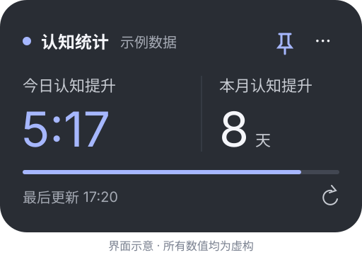

# RenZhi · 认知统计

一个小小的 macOS 悬浮窗，把今天投入的时间和本月正常出勤天数放在眼前。



**[下载安装包](https://github.com/Recqvq/RenZhi/releases/latest) · [隐私说明](PRIVACY.md) · [修改指南](CONTRIBUTING.md)**

## 它做什么

- 256 × 164 的原生小窗，可拖动、可选置顶，记住位置；没有菜单栏图标。
- **今日认知提升**：当天服务端计算的有效时长，达到目标后数字变绿。
- **本月认知提升**：截至今天的正常出勤天数，不统计仅有通行记录但未正常出勤的日期。
- 约每 5 分钟同步，底部只显示最后更新时间；上海时区零点和电脑唤醒后重新查询。
- 可选到点通知；没有截图、OCR、遥测、广告或后台常驻服务。

目前适配 **上海创智学院一卡通 + 飞书桌面版**，不是所有组织都能直接使用的通用考勤工具。项目与学院、飞书均无官方隶属关系。不修改考勤，不代打卡。

## 安装

需要 **macOS 14+**、已登录的飞书，以及本人对该一卡通服务的访问权限。安装包同时包含 Apple Silicon 和 Intel 架构；本地实测 Apple Silicon，Intel 版本为交叉编译。

1. 从 [Releases](https://github.com/Recqvq/RenZhi/releases/latest) 下载 `.dmg`，将应用拖入 Applications；也可下载 `.zip` 解压运行。
2. 打开应用，点击 **连接飞书**。
3. 若提示没有会话，点 **打开考勤**，在飞书里完成一次一卡通登录，等待连接。之后可以关闭考勤页面。

图钉切换置顶，空白处拖动，`…` 菜单中可以同步、开启提醒、断开连接和退出。通知权限可选；不需要屏幕录制或辅助功能权限。

应用目前采用 ad-hoc 签名，**尚未经过 Apple Developer ID 公证**。其他 Mac 首次打开可能需要在“系统设置 → 隐私与安全性”允许打开。无需关闭 Gatekeeper。下载后可使用 Release 中的 `SHA256SUMS` 校验文件：

```sh
shasum -a 256 -c SHA256SUMS
```

安装包未附带任何人的登录状态。只有登录飞书但从未进入学院一卡通的用户，仍需完成一次小程序登录。

## 足够轻

应用核心约 544 行 Swift；本机 Release 构建的通用应用约 1.3 MB，DMG 约 764 KB（工具链不同会有变化）。

原生 Swift + SwiftUI/AppKit，使用 macOS 自带框架。没有运行时第三方依赖、Python/Node 服务或数据库；图标也由仓库内的 Swift 代码绘制。源代码、图标生成器和打包脚本全部采用 MIT 许可。

每次常规刷新只发起两条只读 HTTPS 查询。接口数据可能有服务端延迟，工具不会自行增加时长，也不会把“达到时长目标”等同于所有考勤异常均已消除。

## 从源码构建

只需 macOS 和 Xcode Command Line Tools，不需要 Xcode 工程、Swift Package 依赖或 Homebrew：

```sh
xcode-select --install  # 尚未安装时执行
git clone https://github.com/Recqvq/RenZhi.git
cd RenZhi
./test.sh
./build.sh
open dist/认知统计.app
./package.sh
```

输出位于 `dist/`：通用架构 `.app`、DMG、ZIP 和 SHA-256 校验文件。安装包不进入 Git 历史，发布在 GitHub Releases。

`./test.sh` 使用虚构数据，不访问飞书或网络。`./test.sh --live` 是显式选择的本人账号只读验证，不输出 token 或个人考勤数值。

## 自己修改

| 文件 | 用途 |
| --- | --- |
| `Sources/Views.swift` | 文案、配色和布局 |
| `Sources/AppConfiguration.swift` | 刷新间隔、窗口大小、服务地址、飞书小程序标识 |
| `Sources/AttendanceModel.swift` | 接口、统计口径、跨日处理和提醒 |
| `Sources/FeishuSession.swift` | 本机飞书会话定位和限定来源的 WAL 解析 |
| `Sources/AppDelegate.swift` | 窗口行为、唤醒与连接入口 |
| `Scripts/GenerateIcon.swift` | 图标源代码 |

例如将 `refreshInterval` 改为 `600`，即可每约 10 分钟同步。适配其他组织时，通常还需要修改认证方式、响应结构和统计规则，不能只替换服务地址。详见 [贡献与修改指南](CONTRIBUTING.md)。

## 登录和可靠性边界

这不是飞书官方 OAuth 集成，也不依赖公开的本机取 token 端口。用户主动连接后，应用读取当前飞书浏览器配置中的 Local Storage 日志，只提取一卡通来源的会话键；查询凭证仅在内存使用。详见 [PRIVACY.md](PRIVACY.md)。

- 账号切换时清空旧数据和会话；未能辨认当前配置时停止查询。
- 会话过期、日志压缩进 SST、缓存清理或飞书升级后，可能需要重新点“打开考勤”。不保证所有飞书版本兼容。
- 断网时保留上次成功结果，更新时间变为橙色；悬停可查看原因。
- 飞书退出后，内存中的会话可用至过期；重新启动工具时应先打开飞书。
- 不默认设置开机自启；需要时可通过 macOS“登录项”添加应用。

## 发布与许可

Pull Request 和 `main` 的提交会运行离线测试及双架构构建。维护者推送与 `Info.plist` 一致的 `v*` 标签后，GitHub Actions 会重新构建并发布安装包，不需要个人 GitHub token 或飞书凭证。

[MIT](LICENSE)。欢迎 Fork、修改和分发；提交问题时请勿附上真实 token、登录链接或个人考勤截图。
